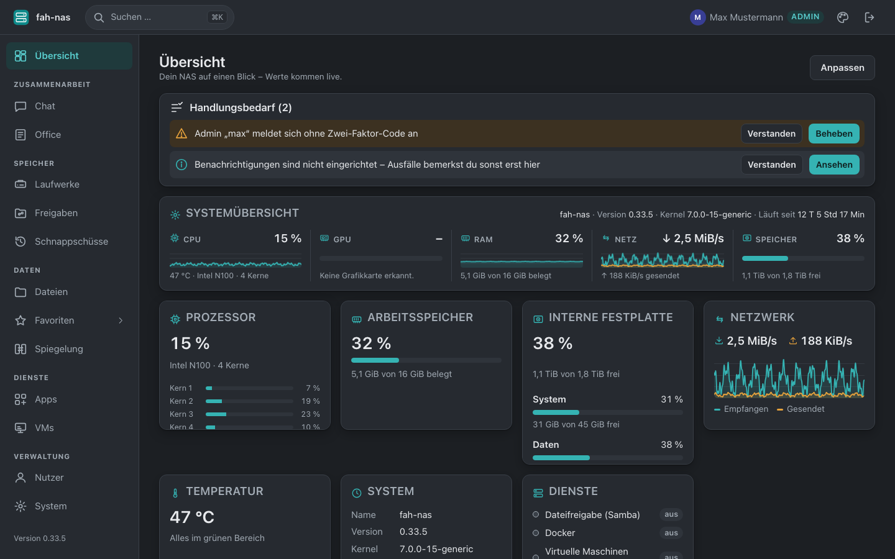
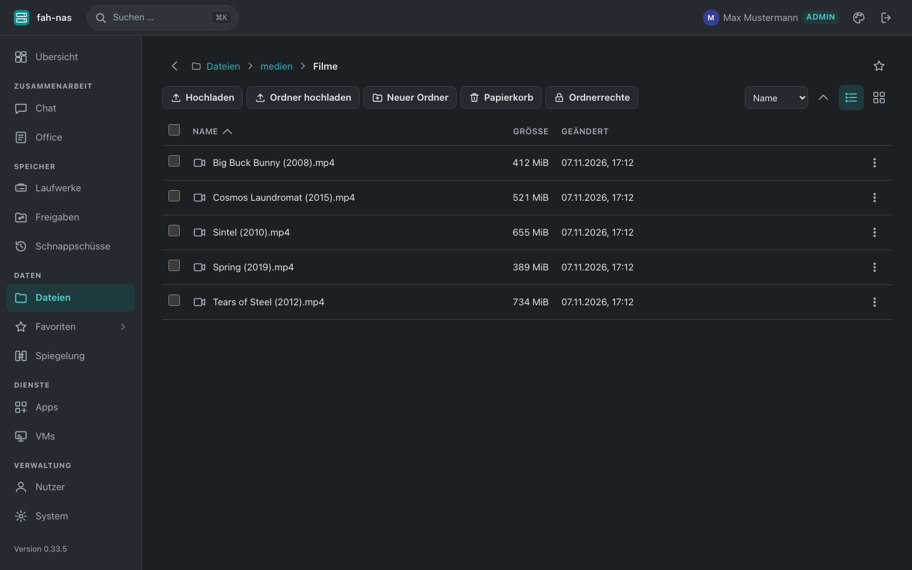
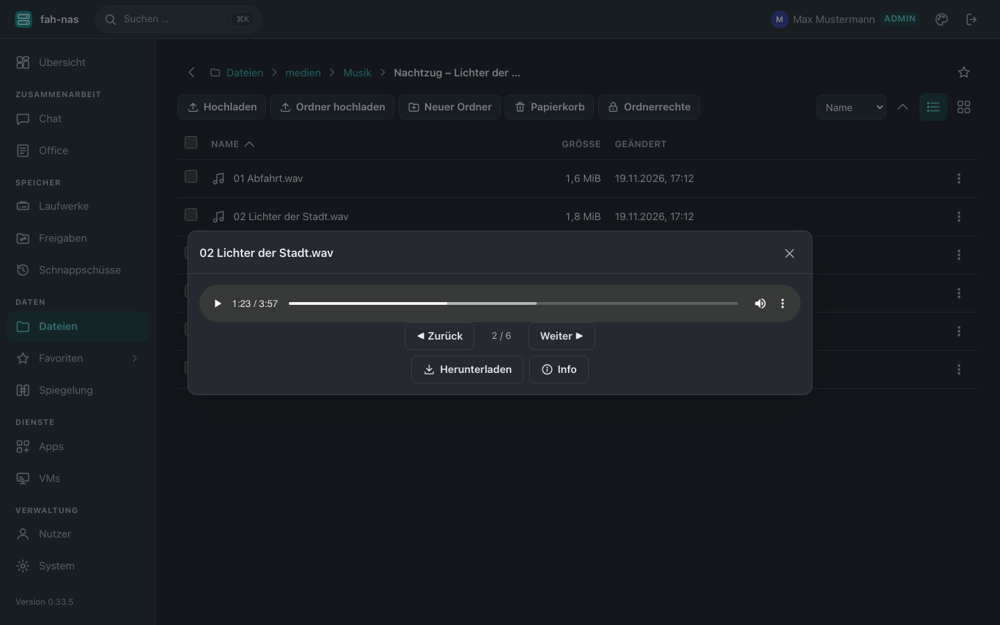
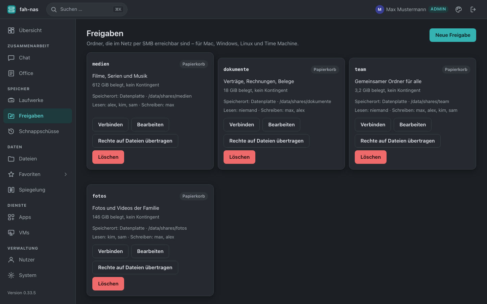
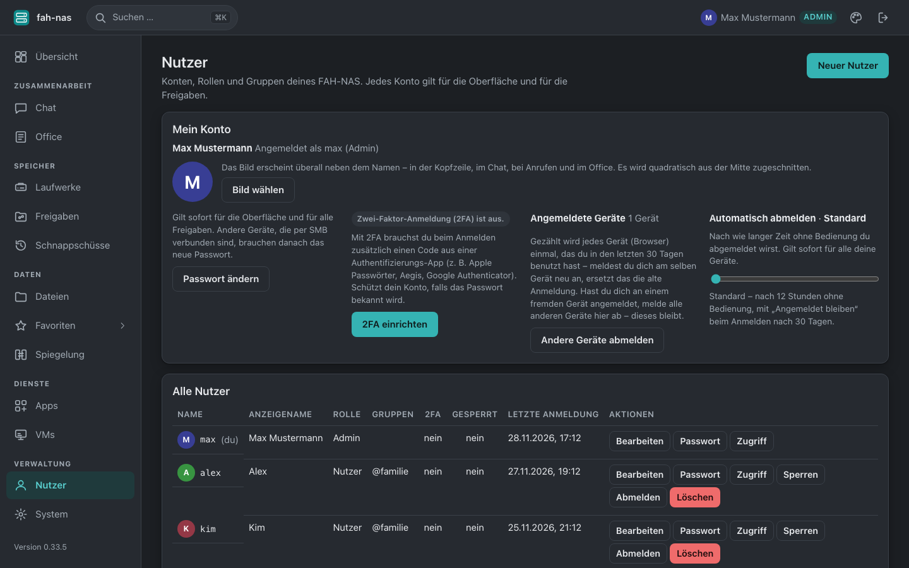
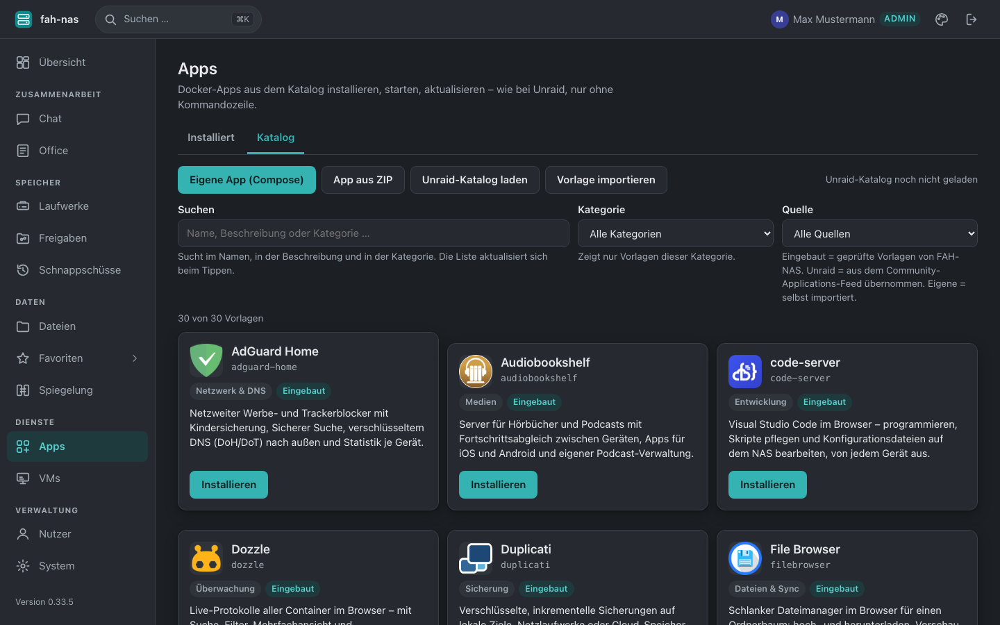
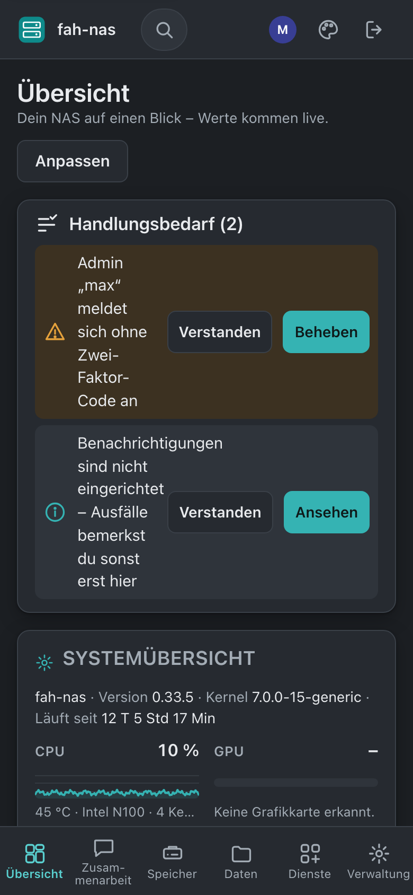

# FAH-NAS – eigenes NAS-Betriebssystem für Mini-PCs

FAH-NAS macht aus einem Mini-PC mit einer internen SSD ein vollwertiges NAS: Freigaben fürs Netz (auch als Time-Machine-
Ziel), Dateimanager im Browser, Schnappschüsse, Nutzer mit Rollen und Zwei-Faktor-Anmeldung, ein App-Katalog für Docker-
Apps, virtuelle Maschinen, Sicherung und Spiegelung auf andere Ziele – alles über eine aufgeräumte Oberfläche im Browser,
auch am Handy. Unterbau ist Ubuntu Server 26.04 LTS.

## ⬇️ Download

**[FAH-NAS-Installer herunterladen (ISO, ca. 1,8 GB)](https://github.com/Arachnolord/fah-nas/releases/latest/download/FAH-NAS-Installer.iso)**

Alle Versionen: [Releases](https://github.com/Arachnolord/fah-nas/releases) · für 64-Bit-PCs (x86-64), Start per UEFI oder BIOS

## So sieht es aus

*Aufgenommen mit erfundenen Beispieldaten (Konto „max“ = Max Mustermann, Nutzer „alex“, „kim“, „sam“, freie Blender-Filme, Demo-Musik).*

**Übersicht** – oben steht, was zu tun ist; darunter laufen CPU je Kern, Arbeitsspeicher, Netz, Temperatur und die Belegung von System- und Datenplatte live mit.

**Dateien** – der Dateimanager im Browser mit Hochladen (auch ganze Ordner), Papierkorb, Ordnerrechten und Listen- oder Kachelansicht.

**Wiedergabeliste** – Musik und Videos laufen ab der angeklickten Datei durch den ganzen Ordner, mit Zurück/Weiter und Zähler; „Info“ öffnet sich darüber, ohne die Wiedergabe anzuhalten.

**Freigaben** – Ordner fürs Netz (SMB, auch als Time-Machine-Ziel) mit Belegung, Speicherort und Lese-/Schreibrechten je Nutzer.

**Nutzer** – Konten und Gruppen mit Rollen, Zwei-Faktor-Anmeldung, angemeldeten Geräten und automatischem Abmelden.

**Apps** – der Katalog installiert Docker-Apps per Klick: geprüfte eingebaute Vorlagen, der Unraid-Katalog, eigene Compose-Apps oder eine App als ZIP.

**Am Handy** – dieselbe Oberfläche, schmal gesetzt, die Bereiche liegen unten als Leiste.

## Das brauchst du

- Einen 64-Bit-PC (x86-64), am besten einen Mini-PC, mit **einer** internen Platte ab 64 GB (256 GB oder mehr empfohlen).
- 4 GB Arbeitsspeicher (8 GB empfohlen), Netzwerk per Kabel.
- Einen USB-Stick ab 4 GB für den Installer.

## Installieren

1. ISO herunterladen und auf einen USB-Stick schreiben, z. B. mit [balenaEtcher](https://etcher.balena.io), Rufus oder
   Ventoy. Vom Stick starten.
2. Im Menü **„FAH-NAS installieren (Platte wird eingerichtet)“** wählen.
   **Achtung: die interne Platte wird dabei neu eingerichtet – alles darauf wird gelöscht.** Ausnahme: Liegt darauf schon
   eine FAH-NAS-Datenpartition, werden die Daten übernommen und nur das System neu aufgesetzt.
   Gibt es mehrere Platten, hält die Installation mit einer Liste an und rät nie – dann die anderen Platten abziehen.
3. Der Installer fragt Name, Rechnername, Benutzername und Passwort. Danach zweimal bestätigen
   („Confirm destructive action“ und am Ende „Reboot Now“).
4. Nach dem Neustart richtet FAH-NAS sich selbst ein. Danach stehen **Adresse und Startcode auf dem Bildschirm**.
5. Adresse im Browser öffnen (z. B. `https://192.168.1.20:8443`), die Zertifikatswarnung bestätigen (selbst
   ausgestellt), Startcode eingeben und den ersten Admin anlegen. Fertig.

## Grafikkarte

Der Installer bringt keine NVIDIA-Treiber mit (das hält die ISO klein). Mit eingebauter NVIDIA-Karte in der Oberfläche
**System → Grafikkarte → „NVIDIA einrichten“** – FAH-NAS lädt Treiber und Container-Toolkit aus dem Internet und richtet
Docker dafür ein (danach einmal neu starten). Intel- und AMD-Grafik brauchen keine zusätzlichen Treiber.
Welche App die Grafikkarte nutzt, stellst du im App-Editor je Dienst ein.

## Was drin ist

- **Freigaben** fürs Netz (SMB), auch als **Time-Machine**-Ziel, mit Papierkorb und Kontingenten
- **Dateimanager** im Browser mit Vorschau für Bilder, Videos, Musik und Dokumente
- **Schnappschüsse** (btrfs) für System und Daten, Rückrollen per Klick
- **Nutzer und Rollen**, Zwei-Faktor-Anmeldung (TOTP), Ordnerrechte
- **App-Katalog** für Docker-Apps, eigene Apps aus einer Compose-Datei, Vorlagen aus dem Unraid-Katalog
- **Virtuelle Maschinen**, **Sicherung und Spiegelung** auf andere NAS, Platten oder Freigaben
- Externe Laufwerke, Energie-Zeitplan, Wake-on-LAN, USV, Benachrichtigungen

## Gut zu wissen

- Updates kommen als Release-Archiv und werden mit `fahnas update <archiv>` eingespielt – vorher legt FAH-NAS
  automatisch einen Schnappschuss an, ein Rückweg ist also immer da.
- Persönliche Daten bleiben auf deinem NAS. Die Weltkarte der Übersicht wertet Adressen nur lokal aus.

## Fremdbestandteile

Ubuntu Server 26.04 LTS (Canonical, freie Lizenzen der jeweiligen Pakete). Ortsdaten: DB-IP.com Country/City Lite
(CC BY 4.0), Karte: Natural Earth (gemeinfrei) – Einzelheiten in [LICENSE-HINWEIS.md](../LICENSE-HINWEIS.md).

---

© 2026 Fabian Hammer – Alle Rechte vorbehalten. Inoffiziell; nicht verbunden mit Canonical, Unraid oder UGREEN.
